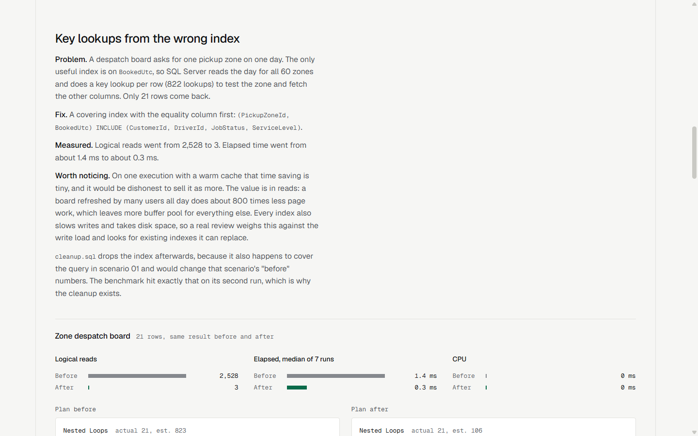

# SQL Server performance case study

A reproducible tuning case study on the schema of Harbour Freight Couriers, a fictional courier company. All data is generated and every name is invented. Five common production problems are reproduced, fixed and measured, and you can rerun all of it on your own machine.



*The results site, generated from `results/`. Screenshot taken in headless Chrome on 4 November 2026.*

## The problem

Slow SQL Server systems are rarely slow for exotic reasons. The same few causes come up again and again, and they are hard to see from application code: a function on an indexed column, an index that nearly fits, a cached plan built for the wrong customer, a parameter of the wrong type, two batches locking tables in opposite order. This repo shows each one with its evidence and its fix.

## Results

Measured on SQL Server 2019 LocalDB (Express edition, compatibility level 150) with 600,000 jobs, 900,000 consignments and 2.19M job events. Each figure is the median of 7 runs with a warm cache, and a run fails if before and after return different rows.

| Scenario | Logical reads before | Logical reads after | Elapsed before | Elapsed after |
|---|--:|--:|--:|--:|
| [01 Function on a date column](scenarios/01-non-sargable-date/README.md) | 6,399 | 2,532 | 108.4 ms | 2.1 ms |
| [02 Key lookups from the wrong index](scenarios/02-key-lookups/README.md) | 2,528 | 3 | 1.4 ms | 0.3 ms |
| [03 Parameter sniffing, large customer](scenarios/03-parameter-sniffing/README.md) | 360,172 | 6,399 | 304.0 ms | 185.1 ms |
| [03 Parameter sniffing, small customer](scenarios/03-parameter-sniffing/README.md) | 6,399 | 57 | 37.7 ms | 1.3 ms |
| [04 Implicit conversion](scenarios/04-implicit-conversion/README.md) | 2,918 | 6 | 66.2 ms | 0.3 ms |

| [05 Deadlock](scenarios/05-deadlock/README.md), 40,000 jobs, two concurrent batches | Deadlocks | Jobs fully processed | Elapsed |
|---|--:|--:|--:|
| Before: opposite lock order, no retry | 20 | 0 | 16.4 s |
| Retry only: opposite lock order, retry on 1205 | 20 | 40,000 | 13.4 s |
| Fixed: consistent order, short batches, retry armed | 0 | 40,000 | 6.9 s |

The raw output, including the plan operators for each case, is in [results/results.md](results/results.md) and [results/deadlock.md](results/deadlock.md). Actual execution plans are in `results/plans` and open in SSMS.

### How to read these numbers

Logical reads are the stable measure: they came out the same on every run. Elapsed times moved by up to about 50% between runs on this machine (scenario 03's large customer ranged from 259 ms to 304 ms before the fix and from 125 ms to 185 ms after), so treat them as orders of magnitude.

This is a small database on a developer machine with everything in memory. On a production server with cold pages, real concurrency and more data, the same read reductions usually matter more, but these exact ratios are not a promise. CPU per scenario is in the raw results; many fast queries show 0 ms because the session counter is too coarse to measure them.

Not every scenario shows a dramatic time saving. Scenario 02 saves about a millisecond per call, and its case rests on the 800 times fewer reads. Scenario 01 cuts reads by only 2.5 times, and most of its gain is CPU. The write-ups say so.

## Live demo

[https://demo.oct28th.com/sqlserver-performance-demo/](https://demo.oct28th.com/sqlserver-performance-demo/)

A static results site generated from `results/results.json`, `results/deadlock.md`, the `.sqlplan` files and the scenario folders: before and after plans with actual rows, reads, timings and the SQL. Nothing is typed in by hand, and the build fails if a plan's row count does not match its results row.

```bash
node static-demo/build.mjs
```

This needs only Node and writes `docs-site/`. Every asset path is relative, so it works under `/sqlserver-performance-demo/`. GitHub Pages only publishes a repo's root or `docs/`, so this folder goes out through a `gh-pages` branch or an Actions workflow. It has not been deployed yet.

There is no Dockerfile, because this repo is scripts and a benchmark rather than a service.

## How to run

You need the .NET 10 SDK (the SQL itself is not version specific) and SQL Server LocalDB with `sqlcmd`. Everything goes into a database called `HarbourDemo`, which the setup script drops and recreates.

```bash
# Build the database, about 20 seconds
bash setup/setup.sh

# Run scenarios 01 to 04 and write results/
dotnet run -c Release --project bench/Bench.csproj

# Run the deadlock repro: two concurrent tasks, three modes
dotnet run -c Release --project scenarios/05-deadlock/DeadlockRepro/DeadlockRepro.csproj
```

To use another server, set `SQL_SERVER` for the setup script and `HARBOUR_CONNECTION` for the two programs. Do not point it at anything you care about: setup drops `HarbourDemo`, and the benchmark clears that database's plan cache.

To look at a scenario by hand, run its scripts directly, for example `sqlcmd -S "(localdb)\MSSQLLocalDB" -E -I -d HarbourDemo -i scenarios/01-non-sargable-date/before.sql`. The `BENCH:` lines are comments that mark what the benchmark measures.

## Layout

```
setup/       schema and a deterministic data generator (no RAND or NEWID, so every run has identical rows)
scenarios/   one folder per problem: before.sql, after.sql, a short write-up
bench/       .NET console that runs before and after, and records time, CPU, reads and the plan
results/     output of the last run
```

## What a client gets in the Health Check

The SQL Server Performance Health Check is a fixed-price review of your database, with the scope agreed in writing first. It uses the same method as this repo:

1. Your slowest and most expensive queries, found from the plan cache and Query Store rather than from guesses.
2. Execution plan analysis of the worst offenders, covering the problems shown here and others such as blocking, missing or duplicate indexes and stale statistics.
3. A deadlock review from the `system_health` session, with the cause of each recurring deadlock.
4. A written report that ranks findings by impact, with before and after measurements wherever I can reproduce the problem safely.
5. Ready-to-review scripts for the recommended changes. You decide what gets applied and when.

Read-only access is enough for the review. Details and contact: [kevindemo.github.io](https://oct28th.com).
